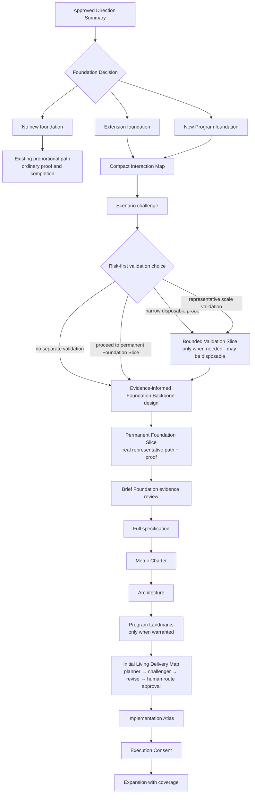
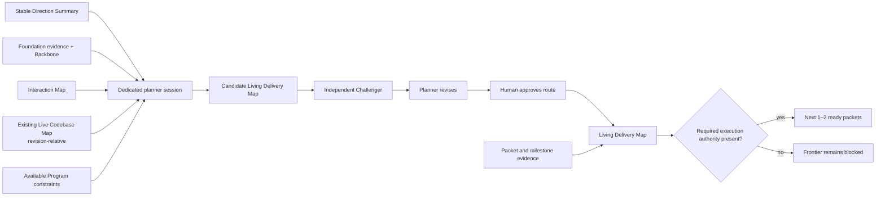
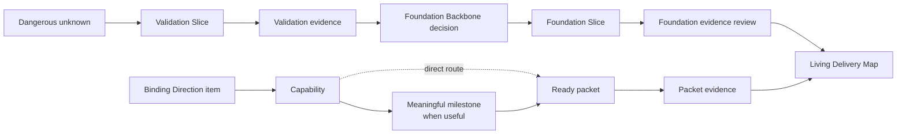

# Foundation-First Delivery Design

Date: 2026-08-01
Status: revised proposed design finding; not current Knowless authority
Companion: [FirstMate Rumble and Direction Skill](./rumble-direction-skill.md)

## Executive finding

A Direction Summary protects human meaning, but cannot by itself keep a large
product internally compatible or prevent “mostly done” from hiding missing
binding outcomes. The earlier foundation-first proposal overcorrected by making
its first learning slice automatically permanent. That confused two different
jobs:

- **validation** reduces a dangerous uncertainty and may be disposable; and
- **foundation** is a deliberate durable commitment made after learning.

The revised proposal uses a compact Interaction Map and risk-first choice to
decide whether validation is needed. Any Validation Slice stays bounded to one
dangerous unknown. Its evidence informs a Foundation Backbone design; the first
durable implementation is a separate Foundation Slice. Direct work that needs
no new foundation bypasses this structure.

After the Foundation Slice, a brief evidence review informs the full Program
and an approved Living Delivery Map. The Map keeps stable Direction connected to
capabilities, meaningful prototype milestones, the next candidate packets, and
their evidence without pretending the entire implementation route is knowable
up front.

This remains a design hypothesis, not a proven optimum. It preserves accepted
FirstMate Studio principles in [PROJECT-STATE](../../../PROJECT-STATE.md) and
[work/06](../../../work/06-firstmate-studio-convergence-engine.md), but proposes
a different ordering for foundation-bearing work. No runtime or authority
change follows from this document alone.

## Problem

Direction establishes what and why. It does not establish all behavioral
relationships, identify who owns important state, reconcile incompatible
capability assumptions, or prove that future work integrates. A full Program
written only from Direction and repository inspection may be internally elegant
but still rest on an untested premise.

Building a production-quality vertical slice immediately is not the answer. If
the purpose is learning, production hardening may spend heavily on a route that
the evidence rejects. If that learning slice is then declared “the foundation,”
its accidental concepts and shortcuts gain authority they did not earn. Two
full builds—one called validation and another called foundation—are wasteful.

The useful separation is:

1. map the interactions that make the product hang together;
2. validate only the unknown dangerous enough to change the durable design;
3. design the smallest evidence-informed durable Backbone; and
4. prove that Backbone through one representative permanent Foundation Slice.

No-code design can expose contradictions, but it does not prove future
integration. Conversely, a working probe proves only what it observed; it does
not automatically prove a reusable foundation.

## Evidence: support without overclaiming

The repository's [evidence ledger](../../../work/02-evidence.md) already labels
Direction-packet and milestone semantics as experiments. A persuasive one-shot
prompt or model response is not evidence of long-running coherence or complete
delivery.

| Evidence | Supports | Does not prove |
|---|---|---|
| [Anthropic, “Effective harnesses for long-running agents”](https://www.anthropic.com/engineering/effective-harnesses-for-long-running-agents) | Durable progress artifacts, incremental work, clean continuation state, and end-to-end validation addressed observed long-horizon failures in one web-app harness. | This artifact sequence, a universal initializer, or that a learning slice should become permanent. |
| [Anthropic, “Effective context engineering”](https://www.anthropic.com/engineering/effective-context-engineering-for-ai-agents) | Compact high-signal context, progressive disclosure, structured external state, and failure-driven prompt refinement. | A universal context size, foundation schema, risk taxonomy, or agent topology. |
| [OpenAI, “Harness engineering”](https://openai.com/index/harness-engineering/) | Depth-first building blocks, repository-local knowledge, mechanical feedback loops, agent-legible runtime evidence, and end-to-end validation mattered in one agent-first product. | That one prompt or one prototype establishes durable architecture, or that the case study generalizes without similar scaffolding. |
| Accepted Knowless foundation | Human-owned Direction, evidence-governed technical claims, adaptive execution, Program Landmarks only when warranted, and a trust tracer before broad fan-out in the substantial example. | The proposed ordering, the right validation choice, the Foundation Backbone, or authority for pre-Program product work. |

The sequence below is an inference to test against the accepted
full-Program-first path, which remains a valid comparison control.

## Revised lifecycle

This diagram is proposed ordering, not current execution authority; the consent
gate is still unresolved in [Authorization remains unresolved](#authorization-remains-unresolved).

For extension and new-foundation work, the conceptual sequence is:

1. approved **Direction Summary**;
2. **Foundation Decision**: no foundation, extension foundation, or new Program
   foundation;
3. compact **Interaction Map**;
4. **scenario challenge**;
5. **risk-first validation choice**;
6. bounded **Validation Slice**, only when needed and possibly disposable;
7. evidence-informed **Foundation Backbone** design;
8. permanent **Foundation Slice** built on the Backbone;
9. brief **Foundation evidence review**;
10. evidence-informed full **Program**: specification, Metric Charter,
   architecture, Program Landmarks when warranted, and an initial Living
   Delivery Map;
11. independent Map challenge, revision, human route approval, Implementation
   Atlas, unresolved **Execution Consent**, and evidence-driven expansion.

“Full Program” means complete enough to support the consent claim, not maximal
ceremony. Extension-foundation artifacts may be compact, and they receive no
Program Landmarks unless their scope warrants them.

“No new foundation” returns to the existing proportional path. A bounded bug or
coherent local feature does not receive a separate Interaction Map document,
validation probe, Backbone, extra gate, or artificial Landmark.

## Foundation Decision

Foundation means the minimum durable concepts and boundaries that several later
capabilities would otherwise reinterpret independently. It is not a mandatory
platform layer or a synonym for “large project.”

| Decision | Use when | Consequence |
|---|---|---|
| **No new foundation** | Existing concepts, state ownership, and invariants already carry the Direction. | Use current authority and the lightest direct route. Do not manufacture foundation artifacts. |
| **Extension foundation** | A stable product exists, but the new capability introduces relationships or variation its foundation does not represent. | Identify reusable contracts and domain-specific assumptions; validate a dangerous unknown only when current evidence cannot answer it before extending the Backbone. |
| **New Program foundation** | No coherent base exists, or planned capabilities share unresolved identity, state, lifecycle, trust, measurement, or extension semantics. | Establish only the durable Backbone exercised by the first representative Foundation Slice. Do not prebuild a general platform. |

Evidence may change the decision. A probe that shows the existing foundation is
sufficient can collapse extension work to the no-foundation route; a scenario
that exposes shared incompatible assumptions can justify a new Backbone.

Record the Foundation Decision and a one-line reason, then show both at the next
existing human touchpoint that already governs Direction, Foundation authority,
or route approval. This makes the bypass or added foundation work auditable
without creating another approval or template.

## Interaction Map

The Interaction Map is an explicit, challengeable artifact describing
behavioral relationships. It is not a claim that an abstract model can enforce
coherence.

It includes only applicable information:

- **behavioral relationships** among actors, capabilities, events, and outcomes;
- **shared state and facts** consumed or changed by more than one behavior;
- **invariants** that all valid paths must preserve;
- **variations** the product must express without contradictory forks;
- **scenario walks** through normal, boundary, failure, and change cases; and
- **high-impact unknowns** whose plausible answers could change the validation
  choice, force a Backbone rewrite, violate Direction, or make planned
  capabilities incompatible.

It points to repository facts where available and labels inference as inference.
It is not an architecture, schema catalogue, exhaustive domain model, graph
scheduler, or progress ledger. On a modest extension it may be one table and a
few scenario walks; it becomes fuller only when interactions demand it.

### Scenario challenge and stopping rule

Challenge walks the human's examples, at least one material boundary, and a
change-over-time or failure case when state is involved. Each finding must be a
relationship correction, contradiction, dangerous unknown, validation choice,
or boundary change. Objection count and reviewer agreement are not quality
signals.

Stop mapping and choose the next stage when every remaining unknown is unable to
change the risk-first validation choice, force a material Backbone rewrite,
violate a binding Direction item, or make planned capabilities incompatible.
This is a falsifiable judgment, not proof. Later evidence can reopen it.

## Risk-first validation choice

Validation is selected from the consequence of being wrong, not project size or
the availability of prototype machinery.

| Choice | Appropriate when | Result |
|---|---|---|
| **None** | Repository evidence and scenario challenge make the durable concept boundary sufficiently clear; a probe would repeat known facts. | Design the Backbone without a separate Validation Slice. |
| **Narrow disposable probe** | One technical or behavioral unknown could overturn the Backbone, and a small isolated experiment can answer it. | Run one bounded Validation Slice; expect to discard its implementation. |
| **Proceed to permanent Foundation Slice** | The risk is understood, the Backbone can be stated, and the real end-to-end path is the cheapest faithful validation. | Skip disposable validation, design the Backbone, and build its representative Foundation Slice. |
| **Representative scale validation** | A plausible volume, latency, topology, or integration limit could invalidate the Backbone and cannot be learned from a toy case. | Validate only the representative risk envelope needed for the decision; do not build the product twice. |

There is no numeric risk score and no universal rule that an ambitious product
requires a probe. The choice and its reason stay visible so later evidence can
show whether validation was excessive or insufficient.

## Validation Slice

A Validation Slice is an intentionally narrow inquiry whose only job is to
answer one dangerous unknown before durable foundation design.

It records:

- the exact question and decision it can change;
- the minimum realistic interaction or scale needed to answer it;
- the observation that will support, contradict, or leave the premise open;
- a strict boundary on time, code, data, infrastructure, and side effects;
- what will be discarded; and
- the evidence and residual uncertainty returned to Backbone design.

It may be a diagnostic-access interaction, diagnostic build, targeted performance
experiment, migration rehearsal, or representative integration probe. It may be
disposable. It must not masquerade as a production foundation through polished
UI, premature abstractions, invented extension points, or claims that the probe
did not observe.

### Avoiding two full builds

Validation ends when its question is answered well enough to choose or revise
the Backbone. It does not expand into a mini-product. Production hardening,
complete content, general APIs, migration support, and broad test portfolios do
not belong unless they are the risk being tested.

Only evidenced lessons survive automatically. Probe code is discarded by
default; if any part is proposed for reuse, it must independently satisfy the
later Backbone and Foundation Slice standards. “It already works” is not a
durability argument.

## Foundation Backbone

The Foundation Backbone is the smallest evidence-informed durable concept layer
that later capabilities may rely on consistently. It is a design commitment,
not the validation implementation and not yet the full Program architecture.

It covers:

1. **stable concepts and relationships** established by Direction, repository
   truth, scenario challenge, and any validation evidence;
2. **ownership and lifecycle of important state**: who creates, changes,
   observes, completes, retires, or recovers it;
3. **capability and extension boundaries** for named variations already in
   evidence, without speculative plug-in systems;
4. **invariants** that implementations and later capabilities must preserve;
5. **compatibility and migration** for existing behavior, data, or integrations
   the foundation must not break;
6. **observability and proof seams** needed to distinguish correct behavior from
   plausible output; and
7. **intentionally deferred or variable decisions**, including what evidence
   would cause them to enter the Backbone later.

The Backbone generalizes only across observed or Direction-required variation.
It must not turn one probe into a universal abstraction, freeze implementation
details that the full architecture should own, or claim integration that no
durable implementation has exercised.

### Backbone readiness rule

Proceed to the Foundation Slice when no remaining uncertainty can plausibly
force a material rewrite of the slice's stable contracts, violate binding
Direction, or make the first planned capability family incompatible. This is a
design stopping rule. The Foundation Slice remains the integration test of the
Backbone claim.

## Foundation Slice

The Foundation Slice is the first durable, representative implementation of the
Backbone. It is not the Validation Slice promoted by default.

It must:

- carry one real user or external-system journey through the actual product;
- prove every binding Direction constraint that touches that exercised journey,
  without requiring proof of unrelated product requirements;
- exercise the Backbone's important state ownership, lifecycle, invariants, and
  extension boundary;
- preserve existing compatibility or perform the intentionally accepted
  migration;
- include enough observability to prove the completion claim and diagnose a
  false success;
- meet the repository's quality bar for permanent code; and
- leave a clear, comprehensible base from which later Program capabilities can
  expand.

The later Metric Charter formalizes measurement; it does not postpone a binding
Direction obligation that already applies to the Foundation Slice journey.

“Representative” means it crosses the interactions whose compatibility matters;
it does not mean maximum scope. A disconnected demo, fake-backend UI, generalized
framework without a real journey, or full product breadth does not qualify.

Internal build gates exist only when dependency handoffs inside the slice need
them. They are engineering coordination checks, not human milestones, Program
Landmarks, or a new route spine.

### Validation Slice versus Foundation Slice

| Property | Validation Slice | Foundation Slice |
|---|---|---|
| Purpose | Answer one dangerous unknown | Establish the first durable Backbone implementation |
| Expected lifespan | May be discarded | Permanent product path |
| Breadth | Minimum experiment needed for the question | Minimum representative end-to-end journey |
| Abstractions | Avoid except where tested | Implement only Backbone-supported concepts and seams |
| Proof | Supports or contradicts one premise | Proves a durable completion claim at an exact revision |
| Completion meaning | Learning complete; product may be unchanged | Foundation behavior works at the proven journey's scope; support for unbuilt expansion remains a design claim |

## Worked example: Formula-style racing game extended to rally

This is a thought experiment, not a claim about any repository or the internals
of an existing game.

### Direction and Foundation Decision

Assume a Formula-style racing game already supports circuit cars, paved tracks,
lap timing, and race sessions. Direction asks it to add rally without turning
the product into a separate game or damaging circuit racing. This is an
**extension foundation** candidate: some game shell may be reusable, while
vehicle/surface behavior and stage/session assumptions may not be.

### Interaction Map

| Concern | Formula-style behavior | Rally variation or unknown |
|---|---|---|
| Vehicle and environment | Vehicle response is tuned around paved circuit contact and circuit cars | Loose gravel must affect controllable vehicle response without breaking paved behavior |
| Course progress | Closed laps, ordered sectors, and lap completion | Point-to-point stage, ordered checkpoints, start and finish |
| Session timing | Lap and race clock, grid/session lifecycle | Stage clock, checkpoint validity, finish result, restart/retire behavior |
| Shared state | Vehicle state, course progress, session clock, result | Ownership boundaries must remain clear when surface, progress, and timing vary |
| Expansion | More circuit cars and tracks reuse established assumptions | Later rally cars, surfaces, stages, weather, damage, and pacenotes must not require contradictory foundations |

Scenario walks include: launch a rally session through the real game flow; start
and finish a point-to-point stage; miss or cross a checkpoint out of order;
restart after a failed attempt; run a circuit session after rally support is
present; and observe vehicle response crossing paved and loose surface.

Two dangerous unknowns emerge:

1. Can the current vehicle behavior support a controllable loose-surface model
   without corrupting paved handling assumptions?
2. Can course progress and timing represent a point-to-point checkpoint stage,
   or are they inseparably lap-based?

### Possible Validation Slice

If repository inspection and no-code scenario work cannot answer those
questions, use a narrow disposable probe: one development car, a blockout strip
of loose surface, start/finish timing, and a few ordered checkpoints. It may use
diagnostic telemetry and placeholder content. It does not need final menus,
career progression, finished art, content pipelines, championship scoring, or a
production save model.

The probe asks only whether the simulation can express controllable
loose-surface response and whether stage progress/timing needs a different
durable contract. Its code is not the rally foundation. The evidence may support
reuse of part of the vehicle simulation, contradict lap-timer reuse, or show
that representative performance validation is needed before Backbone design.

### Evidence-informed Foundation Backbone

Using repository truth and any validation evidence, the Backbone defines:

- stable concepts for **vehicle state**, **surface interaction**, **course or
  stage progress**, **checkpoint validity**, **session timing**, and **result**;
- ownership and lifecycle: the vehicle owns motion state; surface interaction
  influences that state; the session owns stage start, checkpoint progression,
  completion, restart, and result publication;
- capability boundaries for circuit lap progression versus rally stage
  progression, and paved versus loose-surface response;
- invariants such as ordered required checkpoints before a valid finish, one
  authoritative session clock, and circuit behavior remaining compatible;
- migration or adapters required for existing lap/session behavior, without
  declaring one representation universal prematurely;
- observability through vehicle/surface telemetry, checkpoint events, timing
  events, and result traces; and
- variable or deferred decisions such as pacenotes, weather, complex damage,
  championships, multiple rally cars, and additional loose surfaces.

These are conceptual contracts, not prescribed APIs or proof that their future
integration will work.

### Permanent Foundation Slice

The Foundation Slice is one real rally car, one short gravel stage, the actual
game/session entry path, ordered checkpoints, start-to-finish timing, a result,
and restart behavior. It uses production-quality implementations of the
Backbone concepts and leaves appropriate reusable seams for another car, stage,
or surface without building those expansions now.

Proof exercises the complete journey in the running game, observes loose-surface
vehicle behavior and checkpoint/timing traces, confirms invalid checkpoint
orders cannot produce a valid result, repeats after restart, and confirms a
representative circuit session still works. Durable automated checks protect
stable timing and progress invariants; human or telemetry-assisted play checks
cover behavior not faithfully established by isolated assertions.

The slice does not claim complete rally support. Pacenotes, weather, damage,
championships, content breadth, multiple vehicles, and representative maximum
stage scale remain visible as deferred or still remaining according to actual
authority—never silently complete.

### Post-slice route illustration

The evidence review can now say narrowly that one rally car completes one short
gravel stage through the real session path, ordered checkpoints and timing hold,
restart works, and the representative circuit regression still passes. It must
also retain what remains uncertain: whether the seams hold for another vehicle
or stage, whether representative stage scale changes timing or loading, and
whether later navigation or event progression needs additional Foundation work.

An initial Delivery Map might therefore name capabilities such as repeatable
rally-stage play, safe vehicle/content variation, navigation, and multi-stage
progression. A meaningful prototype milestone could be “a player completes two
materially different rally-stage configurations through the same durable loop,”
with observable compatibility and result proof. Only the next one or two
credible packets would then receive detailed contracts; distant content and
event ideas remain candidates. This illustrates route shaping, not a claim that
a production racing game—or any fixed-hours version of one—is realistic.

## Foundation evidence review

The permanent Foundation Slice ends with a short evidence review before the
remaining Program and route are elaborated. At the exact reviewed revision it
records:

1. **proved:** which completion claim, applicable binding Direction constraints,
   Backbone invariants, compatibility paths, and observable interactions have
   evidence;
2. **failed or uncertain:** what did not work, was not exercised, or remains
   outside the evidence envelope;
3. **Foundation boundary result:** which concepts, state ownership, lifecycle,
   extension seams, and proof seams held or require an explicitly authorized
   Foundation change; and
4. **future capability consequence:** which planned capabilities the evidence
   supports, which assumptions the Program must remove, and which capabilities
   may require later Foundation work.

This is a compact decision input, not a retrospective essay or a declaration
that future integration is proven. Ordinary Foundation findings inform the
initial Program and Delivery Map or revise their later versions. A material
Backbone change returns to the human gate and the still-unresolved authorization
model; it is not smuggled through route planning.

## Living Delivery Map

The Living Delivery Map is the durable project-level route from stable Direction
through observable capabilities, meaningful prototype milestones when useful,
candidate packets, and their evidence. Direction preserves what and why; the Map
is a revisable delivery theory. It changes when evidence exposes a better route,
a hidden dependency, an invalid assumption, or completed work. A Direction
change instead versions the Direction Summary and re-evaluates the whole Map.

The Map is appropriate for substantial work whose route cannot fit honestly in
one direct Mission. Small bug fixes and coherent local changes stay on the direct
route. Foundation-first does not mean map-first for every request.

### Dedicated planner session and challenge loop

Initial Map creation happens in a dedicated planner session using:

- the approved Direction Summary;
- the Foundation evidence review and Foundation Backbone;
- the Interaction Map;
- the existing revision-relative
  [Live Codebase Map](../../../PROJECT-STATE.md#accepted-direction); and
- any already-synthesized specification, metric, architecture, or Program
  Landmark claims that constrain the route.

This reuses Knowless's existing repository-orientation source: executable truth,
generated inventory, curated routing pages, source fingerprints, and budgeted
revision-bound Context Views. It does not create a second codebase map or a
manually maintained knowledge copy.

The planner proposes the route; it does not deeply specify the whole backlog.
It names capabilities, meaningful integrated milestones, real dependencies and
unknowns, candidate packets, and the initial ready frontier.

Route approval therefore cannot make a packet `ready` while required execution
authority is absent.

The independent Challenger receives the same authoritative source artifacts and
evidence as the planner, plus the candidate Map. It never receives the planner's
private reasoning or persuasive transcript; it reconstructs its challenge from
the shared sources.

The Challenger is skeptical but bounded. It checks:

1. coverage of binding Direction outcomes, boundaries, examples, and failure
   signals;
2. whether milestones express meaningful product capability or prototype proof
   rather than technical activity;
3. compatibility with the Foundation Backbone and its evidence envelope;
4. hidden dependencies, unsafe ordering, and missing integration paths;
5. unjustified assumptions presented as facts;
6. missing proof for a milestone completion claim; and
7. packet candidates that are too broad to close coherently.

The Challenger protects route quality. It does not choose product Direction,
invent non-goals, silently strengthen preferences, or decide human trade-offs.
One independent pass is the default. A second pass is justified only when the
first exposes a material contradiction and the revision substantially changes
the route; reviewer repetition is not evidence.

Human route approval follows planner revision. It confirms that the proposed
capability order, meaningful milestones, deferred scope, and material
trade-offs remain faithful to Direction. It is not approval of every packet or
proof that technical assumptions are true. Whether this approval is part of,
precedes, or remains separate from Execution Consent is intentionally unresolved.

### Map contents and route statuses

The durable Map contains only information needed to preserve route honesty:

- the current Direction and Foundation evidence basis;
- capabilities and their binding Direction coverage;
- meaningful milestones and their observable completion proof;
- actual dependencies, high-impact unknowns, and Foundation touchpoints;
- candidate packets, with detail only at the ready frontier;
- evidence links and semantic coverage status; and
- short revision notes explaining evidence-driven route changes.

Every capability, milestone, and packet candidate uses one route status:

| Status | Meaning |
|---|---|
| **candidate** | Plausible route item, deliberately not ready or deeply specified. |
| **ready** | Dependencies, current evidence, authority, and a coherent outcome permit detailed contracting now. |
| **blocked** | A named dependency, decision, authority boundary, or external condition prevents progress. |
| **uncertain** | A consequential premise or route remains unresolved; the item must not masquerade as ready. |
| **completed** | Its stated outcome and claim-appropriate proof are satisfied; the evidence basis and a revision reference when materially useful are recorded. Broader Direction coverage is tracked separately. |
| **invalidated** | Evidence or an authorized change disproved the route item or its prerequisites; it remains visible with the reason and successor, if any. |

These are route states, not confidence scores. `completed` does not automatically
mean the corresponding binding Direction item is `proven`, and changing the Map
does not change Direction.

A **meaningful prototype milestone** is an integrated product capability or
learning plateau a human can understand and for which evidence can support a
clear claim. It is not “database done,” “API complete,” or a fixed calendar
interval. On substantial work it may coincide with a Program Landmark. Smaller
prototype milestones appear only when they create genuine integration leverage
or a material product decision.

The Delivery Map is the evolving route source behind the relevant route view in
the Implementation Atlas; the Atlas remains a consent presentation rather than
a duplicate operational truth. The Map is not a universal dependency graph, a
complete task decomposition, or the historical Milestone Spine.

### Leverage-based review

Human attention stays at leverage points:

- approve Direction and later material Direction changes;
- approve a material Foundation boundary change;
- approve the initial Delivery Map route and milestone-level trade-offs; and
- make human-owned decisions when evidence cannot preserve the approved route.

Routine packet completion relies on the packet's evidence, not human ceremony.
Independent review is used for the initial Map, a meaningful milestone, a
high-risk packet, or surprising evidence. It is not required for every packet,
commit, debugging step, or local correction.

These review points do not silently resolve the existing consent ambiguity.
Direction confirmation, route approval, authorization for a Validation or
Foundation Slice, and Execution Consent remain distinct until Knowless accepts
an explicit reconciliation.

## Packet lifecycle

Only the next one or two `ready` packets receive a detailed delivery contract.
Distant candidates retain outcome, dependency, and proof intent but avoid
speculative technical detail. Completing or invalidating a packet moves the
frontier only after clean-close write-back and may cause the planner to refine
the next candidates.

### One-shot delivery contract

A ready packet contains:

- **single outcome:** one observable, integrable state the run must leave true;
- **Foundation link:** the Backbone concepts, invariants, compatibility, and
  proof seams it uses or must not violate;
- **scope and non-scope:** the minimum coherent boundary and named exclusions;
- **interactions:** the end-user, external-system, state, and integration paths
  that make local success insufficient;
- **dependencies:** exact accepted artifacts, predecessor evidence, repository
  revision, authority, and unresolved blockers;
- **proof:** the checks and observations that distinguish completion from
  plausible output; and
- **unlock:** which capability, milestone, or packet becomes newly credible if
  the outcome is proved.

“One-shot” means one coherent agent run can reach a clean, integrated, verified
state with no known contract work left behind. It does not mean one model
attempt, forbid internal planning, debugging, tests, or iteration, or require
the agent to persist after evidence shows the contract is wrong.

### Clean close

A packet is not cleanly closed until the Living Delivery Map records its
resulting route status and links the evidence that supports that status. Include
the exact repository or artifact revision only when it materially improves
traceability, such as when later work depends on the changed code or evidence
basis. Record any discovery classification that changes the remaining route.

Evidence must fit the claim. It may be automated, diagnostic, visual,
human-observed, or a justified combination; clean close does not impose a
universal mechanical-test regime. Narrative confidence alone is not evidence,
and write-back is part of the packet outcome rather than a later bookkeeping
task or a new human review gate.

### Sizing heuristics

Packets are not equal time slices and do not receive arbitrary division. A
useful operating target is roughly 30–90 minutes of agent work including proof;
some integration-heavy packets may reasonably approach two hours. These are
frontier-shaping heuristics, not estimates, deadlines, performance guarantees,
or reasons to weaken proof.

If a packet cannot close after roughly 90 minutes, stop treating persistence as
progress. Classify whether a hidden dependency, design error, tool limitation,
or Foundation pressure is responsible, then split, reframe, unblock, or replan.
Continue the same packet only when concrete evidence shows the remaining work is
still one coherent outcome and the longer integration path is justified.

### Post-packet discovery classification

After proof or a material failure, classify the discovery by the smallest layer
whose premise is wrong:

| Discovery | Test | Response |
|---|---|---|
| **Packet problem** | The outcome remains valid; local implementation, proof, or bounded scope was wrong. | Repair, split, or retry the packet without replanning the project. |
| **Delivery Map problem** | The Foundation still holds, but ordering, dependency, milestone, or remaining route is wrong. | Replan the affected remaining Map; preserve completed evidence and stable Direction. |
| **Foundation problem** | Evidence shows a cross-packet failure or conflicts with a Backbone concept, invariant, state owner, lifecycle, compatibility, or extension boundary. | Reopen the Backbone and obtain the required human/authority decision before dependent work continues. |
| **Direction pressure** | Evidence contradicts a binding Direction requirement, exposes incompatible binding requirements, or shows one cannot be satisfied as approved. | Pause only work that depends on the contradiction and escalate the evidence and consequences to the human; independent work may continue. Do not relabel it as Map or Foundation pressure. |

Route change alone is not Foundation failure. Reopening the Backbone requires
cross-packet pressure or evidence against a Foundation assumption, not a planner
finding a better sequence.

Direction pressure does not authorize an agent to reinterpret or defer binding
meaning, and it does not freeze unrelated project work. The human may preserve
or version Direction through the existing authority path before dependent work
resumes.

### Milestone learning record

At a meaningful milestone, append four terse facts to the Map:

- what worked and its evidence;
- what failed or surprised;
- what changed in the remaining Map; and
- whether the Foundation held, needs later work, or requires reopening now.

This is the durable learning needed for the next planner and Challenger, not a
meeting transcript, narrative report, or new approval document.

## Evidence and semantic coverage

Validation evidence answers a design unknown; it is not product-completion
evidence. Backbone design makes durable claims; the Foundation Slice supplies
the first integration evidence for those claims. The Program and Living
Delivery Map then expand coverage without forgetting what remains.

- **Validation evidence** supports a named premise at its tested envelope. It
  expires as support when the relevant environment or assumption changes.
- **Foundation evidence** proves the Foundation Slice claim at an exact
  revision. Later changes that invalidate it return the mapped claim to
  `still remaining` until re-evidenced.
- A **Program Landmark** is a broad, demonstrable human-facing capability only
  when substantial scope warrants it.
- A **Packet** is the smallest owned, integrable outcome contract that advances
  a capability, milestone, or Direction item. It is not a permanent task
  breakdown or Milestone Spine node.

Each binding Direction item retains one semantic coverage status:

| Status | Meaning |
|---|---|
| **proven** | Named evidence supports the mapped claim at the required scope and current evidence basis. |
| **explicitly deferred** | The human deliberately moved it outside the current completion boundary; a binding release item cannot acquire this status silently. |
| **intentionally changed** | Authorized Direction or Program change records what changed and invalidates affected mappings; binding meaning changes require a new Direction version. |
| **still remaining** | It is not proven, validly deferred, or intentionally changed and blocks the relevant completion claim. |

Route status and semantic coverage answer different questions. Candidate,
ready, blocked, uncertain, completed, and invalidated describe the current route;
proven, explicitly deferred, intentionally changed, and still remaining describe
whether binding meaning is satisfied. Validation cannot mark a product
capability proven merely because the experiment succeeded.

## Testing posture

Testing grows with the claim being made:

- **Interaction Map and Backbone design:** scenario challenge, repository
  evidence, and explicit contradictions improve the design but do not prove
  integration.
- **Validation Slice:** use the lightest faithful diagnostic, manual interaction,
  simulation, benchmark, migration rehearsal, or end-to-end probe needed for
  its one question. Avoid a general test bureaucracy around disposable code.
- **Foundation Slice:** meet the repository's permanent quality bar; exercise the
  real end-to-end path; automate stable high-risk invariants and compatibility;
  prove binding Direction constraints that touch the journey; and retain
  human/diagnostic evidence where automation cannot establish the claim.
- **Delivery Map:** challenge Direction coverage, product meaning of milestones,
  Foundation compatibility, dependency order, assumption basis, milestone proof,
  and frontier packet breadth. This improves the route; it does not prove code.
- **Ready packet:** use contract-specific checks and the real affected
  interactions so the run ends clean and integrated rather than merely locally
  plausible; write the resulting evidence and route status back to the Map.
- **Meaningful milestone:** exercise the integrated capability and its failure
  signals; use independent review when the milestone carries material leverage.
- **Expansion and completion:** use claim-specific evidence, relevant integrated
  checks, and the full project-mandated suite. No binding item can disappear
  behind a green local test.

This sequences learning; it does not lower an existing repository's test bar.

## Relationship to accepted Knowless authority

### Preserved

This proposal retains human-owned Direction, differentiated authority,
challenge-and-revision, repository-local accepted knowledge, private raw Rumble
material, evidence over model confidence, adaptive direct/staged/fork-join/graph
execution, one to five same-provider workers only when justified, and Program
Landmarks only for substantial Programs. These are current decisions in
[PROJECT-STATE](../../../PROJECT-STATE.md) and
[work/06](../../../work/06-firstmate-studio-convergence-engine.md).

It also remains compatible with work/06's substantial example, where a shared
trust tracer precedes broad fan-out, and the non-canonical
[Execution Economy sidecar](../../../work/07-execution-economy/README.md), which
argues for coarse distant horizons and precise current vertical work.

The historical [Milestone Spine](../../../work/05-required-milestones-live-map.md)
is not revived. The Interaction Map does not schedule work, the Backbone is not
an agent-owned partial order, the Delivery Map is not a fully decomposed graph,
Packets are not mandatory milestones, and internal dependency gates are not
human-facing route truth.

### Deliberate proposal, not current authority

Work/06 currently synthesizes specification, Metric Charter, architecture,
Program Landmarks, and the Atlas before Execution Consent and product execution.
This proposal allows bounded validation and a permanent Foundation Slice to
inform those artifacts. That is a material lifecycle change requiring explicit
acceptance; it is not already authorized by existing wording.

The Living Delivery Map is likewise proposed rather than accepted Knowless
authority. It would carry the evolving capability route and ready frontier
behind the relevant Implementation Atlas view; it would not replace Direction,
the Program's specification/metrics/architecture, the current execution design,
or the runtime Outcome Ledger.

The current full-Program-first path remains the comparison control. It may prove
better where repository evidence is rich, validation would duplicate work, or
the authority cost of pre-Program execution outweighs its learning value.

## Authorization remains unresolved

The reviewed [Rumble design](../specs/2026-08-01-firstmate-rumble-direction-summary-design.md)
proposes early Direction Approval but is itself not current authority and states
that Direction Approval does not authorize implementation. Current work/06 puts
Execution Consent after the complete Program.

Neither a disposable Validation Slice nor a permanent Foundation Slice may be
silently authorized by Direction confirmation. Even disposable work can write
code, use data, consume resources, or cause external effects. Permanent
foundation work is plainly product execution.

Human approval of the Delivery Map route also does not silently authorize
packet execution. Whether route approval is one part of the existing Execution
Consent decision, a separate earlier planning acknowledgment, or a new gate is
unresolved and must be reconciled without adding approval ceremony by default.

Possible reconciliations include:

1. **One bounded Foundation Learning Consent** after the Interaction Map and
   risk choice, authorizing a named validation envelope if needed and one
   Foundation Slice within explicit limits; later Execution Consent authorizes
   expansion. Material validation findings would have to refresh the Foundation
   Slice boundary before permanent work.
2. **Separate Validation and Foundation consents**, precise but potentially
   over-ceremonial, followed by existing Execution Consent for expansion.
3. **Move Execution Consent earlier** to authorize Backbone/Foundation work and
   add a later Expansion Consent, changing the accepted gate's meaning.
4. **Keep the current full-Program-first path**, allowing only non-mutating
   research before Execution Consent. This rejects pre-Program product learning
   but preserves current authority.

No option is accepted here. The exact boundary between non-mutating research,
disposable code, permanent foundation work, and expansion authority is the main
open decision before a pilot.

## Earlier independent review disposition

Claude Code Fable, at high effort with repository tools disabled, independently
reviewed the validation-versus-foundation revision for boundary contradictions,
duplicate artifacts, authority errors, vague terms, and accidental process. It
made no repository edits. That review predates the Living Delivery Map amendment
and is not evidence that the later workflow has been independently validated.

Accepted corrections:

- use one name for the direct-to-Foundation-Slice risk choice;
- restrict Foundation Slice proof to the exercised journey rather than claiming
  it proves unbuilt expansion;
- annotate the proposed pre-consent ordering at the lifecycle diagram;
- state that extension-foundation Program artifacts scale proportionally;
- keep the pilot neutral among unresolved authorization models; and
- distinguish a diagnostic-access probe from blockout game geometry.

Rejected advice:

- routing every extension out of the Program sequence after its Foundation
  Slice would contradict the proposed sequence and obscure the consent artifact;
  proportional artifact depth and optional Landmarks address the valid concern;
- numeric risk scores, a mandatory Interaction Map schema, and forced artifact
  merging would add ceremony or erase the validation/foundation boundary; and
- selecting an authorization model, expanding citations, or adding rally-domain
  detail here would exceed this document's evidence and authority.

## Risks and controls

- **Validation creep:** the probe becomes a hidden first build. Control: one
  question, bounded envelope, explicit discard boundary.
- **Prototype contamination:** accidental probe concepts enter production.
  Control: only evidence transfers automatically; code must independently meet
  Backbone and Foundation Slice standards.
- **Two full builds:** validation and foundation duplicate production effort.
  Control: skip validation when the real Foundation Slice is the cheapest
  faithful test; never productionize the probe for appearance.
- **Backbone over-generalization:** one observed case becomes a speculative
  platform. Control: generalize only across named Direction-required or observed
  variation.
- **Backbone under-modeling:** durable work begins while a relationship can still
  force rewrite. Control: Interaction Map, hostile scenarios, and the readiness
  rule.
- **No-code false confidence:** a clean design is treated as integration proof.
  Control: the Foundation Slice must exercise the real path.
- **Foundation anchoring:** the first permanent route resists later evidence.
  Control: Backbone decisions are evidence-governed and versioned; invalidated
  proof returns to `still remaining`.
- **Authorization drift:** bounded learning becomes broad execution. Control:
  explicit unresolved gate and capability limits outside the prompt.
- **Deferral laundering:** difficult outcomes disappear behind slice scope.
  Control: exact coverage statuses and no silent deferral.
- **Process inflation:** every request receives maps, probes, Backbones, and
  gates. Control: no-foundation bypass and measured artifact burden.
- **Testing debt:** “still learning” becomes a permanent excuse. Control:
  permanent quality bar and durable checks on stabilized high-risk behavior.
- **Map ossification:** candidate order is mistaken for Direction. Control:
  stable Direction references plus visible evidence-driven invalidation and
  revision notes.
- **Planning fan-out:** the whole backlog receives packet-level detail. Control:
  deeply contract only the next one or two ready packets.
- **Review theater:** planners and Challengers repeat prose without changing the
  route. Control: the Challenger reconstructs from the planner's authoritative
  source basis without its private reasoning, with one rubric-bound pass by
  default and another only after a material contradiction.
- **Premature completion:** route `completed` is confused with semantic
  `proven` or asserted without durable evidence. Control: retain separate route
  and coverage statuses, and require claim-appropriate evidence plus Map
  write-back at clean close.
- **Foundation churn:** ordinary packet or sequencing failures reopen durable
  concepts. Control: require cross-packet pressure or conflict with a Backbone
  assumption.
- **Timebox grinding:** an agent keeps forcing a bad contract to meet a duration
  target. Control: treat duration as a diagnostic heuristic and classify the
  pressure instead of weakening proof.
- **Human review overload:** routine work waits for approval. Control:
  leverage-based gates and evidence-led packet closure.

## Rejected alternatives

- **Validation Slice automatically becomes Foundation Slice:** confuses learning
  with durable commitment and promotes accidental design.
- **Production-quality Validation Slice followed by a second full build:** pays
  twice before the first Program; validation must stay narrow.
- **Reuse probe code by default:** transfers accidental shortcuts rather than
  evidenced lessons.
- **Always validate before Backbone design:** repeats known facts and creates
  ceremony; risk-first choice may select none or a direct Foundation Slice.
- **Backbone from Direction alone as proven truth:** no-code design does not
  establish integration.
- **Giant Interaction Map or full up-front domain model:** crowds out current
  evidence and prematurely freezes variation.
- **Mandatory Milestone Spine or universal graph:** superseded by adaptive
  execution and unnecessary for direct work.
- **Full testing bureaucracy around disposable probes:** hardens experiments
  instead of learning from them.
- **No coverage mechanism:** permits binding outcomes to disappear as local
  plans change.
- **Complete detailed packet backlog:** creates stale context and false
  sequencing; only the ready frontier receives delivery contracts.
- **Human approval for every packet or commit:** spends attention below the
  leverage boundary and stalls iteration.
- **“One-shot” as one model attempt:** discourages diagnosis, tests, and
  evidence-led iteration inside one coherent run.
- **Equal packet time division or guaranteed duration:** mistakes an operating
  heuristic for a project estimate and hides integration shape.
- **Reopen Foundation after every route change:** confuses delivery theory with
  durable concept failure.
- **Delivery Map as a renamed Milestone Spine:** reintroduces mandatory graph
  ceremony, premature decomposition, and agent-owned route authority.

The full-Program-first path is not rejected; it is the valid control against
which the proposal must earn its extra artifacts and authorization cost.

## Open decisions

1. Which authorization model, if any, permits bounded validation and permanent
   foundation work before the existing full Program and Execution Consent?
2. Is the Interaction Map durable for substantial work or generated from
   Direction, current sources, and decisions?
3. What evidence threshold distinguishes “no validation needed,” a narrow probe,
   a direct Foundation Slice, and representative scale validation?
4. Which Validation Slice artifacts, if any, may survive, and what independent
   standard governs reuse?
5. What is the smallest durable representation of the Foundation Backbone?
6. What minimum measurement definition makes a binding safety or metric
   constraint that touches validation or the Foundation Slice provable before
   the full Metric Charter formalizes the broader system?
7. What projects and failure seeds make a fair comparison with the current
   full-Program-first path?
8. How does human Delivery Map approval relate to the current single Execution
   Consent without adding an ambiguous or redundant approval?
9. What is the smallest repository representation and revision protocol that
   keeps the Living Delivery Map current without duplicating the Atlas or
   Outcome Ledger?
10. Which evidence or scope threshold makes a prototype milestone meaningful
    enough to warrant independent review?

## Minimum viable pilot for Knowless

Implementation waits for authorization reconciliation. If a pre-Program pilot
is authorized under whichever model is explicitly accepted, keep it manual and
bounded rather than building a new control plane. The steps below describe
lifecycle mechanics, not a preference among the consent options:

1. Select one extension-shaped project with a real shared-state or integration
   risk and preserve an approved Direction Summary.
2. Record a compact Interaction Map, scenario challenge, Foundation Decision,
   its one-line reason, and the explicit risk-first validation choice.
3. If validation is selected, obtain the accepted form of authorization and run
   one bounded Validation Slice; retain its evidence and discard its
   implementation unless later reviewed independently against the Backbone.
4. Design the smallest Foundation Backbone from Direction, repository truth,
   scenario findings, and validation evidence.
5. Before permanent work, obtain or refresh whatever authorization boundary the
   accepted model requires if learning materially changed it; then build one
   Foundation Slice with end-to-end evidence at an exact revision.
6. Record the brief Foundation evidence review, then synthesize the full
   specification, Metric Charter, architecture, and Program Landmarks when
   warranted.
7. In a dedicated planner session, propose the Living Delivery Map from
   Direction, Foundation evidence/Backbone, Interaction Map, and the existing
   revision-relative Live Codebase Map; give the same authoritative sources—but
   not planner reasoning—to one independent Challenger pass, revise, and obtain
   the accepted form of human route approval.
8. Present the approved route through the Atlas, reconcile and obtain Execution
   Consent, then contract only the next one or two ready packets.
9. Clean-close each packet by writing evidence and route status to the Map, then
   classify Packet, Map, Foundation, or Direction pressure. At meaningful
   milestones append the four-field learning record and re-challenge only when
   risk or surprising evidence warrants it.
10. Block completion while any binding item is `still remaining`, and compare
   against a matched full-Program-first project on rewrite cost,
   integration defects, missed binding outcomes, time to decisive evidence,
   duplicated implementation, artifact burden, and authorization burden.

A pilot success is evidence for another comparison, not proof of universal
superiority. Automation of artifact lifecycles, coverage checks, or UI follows
only if repeated benefit justifies the control-plane cost.

## What remains before operationalization or a pilot

This boundary applies only when work has justified the Foundation-first route.
Direct and proportional work remains direct; these items do not make the full
workflow universal.

1. **Resolve authorization and consent.** Decide who, if anyone, may authorize a
   disposable Validation Slice and permanent Foundation work before a full
   Program has Execution Consent. This document does not choose a policy. Until
   Knowless accepts one explicitly, Direction approval and Delivery Map route
   approval authorize neither kind of work.
2. **Define the minimal runtime contract.** For eventual FirstMate integration,
   keep approved Direction versions and the Living Delivery Map in the target
   repository: the human owns Direction meaning, while FirstMate owns
   evidence-linked route maintenance inside that meaning. The packet executor
   produces claim-appropriate evidence; the coordinator owns clean-close Map
   write-back of packet status and evidence references. Durable handoff state
   stays in the existing
   [Outcome Ledger and execution-spine layer](../../../work/06-firstmate-studio-convergence-engine.md#program-execution-design-and-plan)
   in FirstMate's local service, never only in a model's private reasoning. Once
   required authority exists, an implementer receives the next one `ready`
   packet as a compact Mission Frame compiled from its contract, accepted
   evidence, Map basis, and relevant repository revision—not the whole planning
   history. This is a minimal future integration contract, not current runtime
   behavior; filenames, schemas, and extra stores remain deliberately
   unspecified.
3. **Run one real medium-sized pilot.** Use a project with enough shared state,
   integration, and route uncertainty to exercise Foundation evidence, several
   packets, at least one meaningful milestone, and evidence-driven Map revision.
   Observe whether the artifacts improve Direction fidelity, dependency
   discovery, clean closure, handoff continuity, and coherent prototype delivery
   or merely sound plausible while adding context and review cost. Additional
   roles, scoring systems, mandatory templates, and heavy test mechanisms wait
   for pilot evidence.
